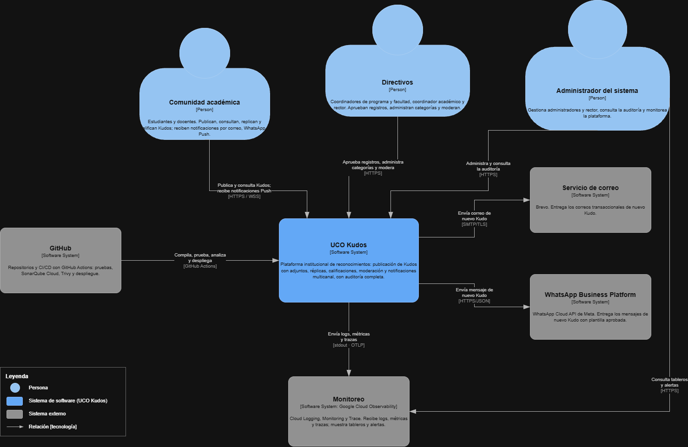
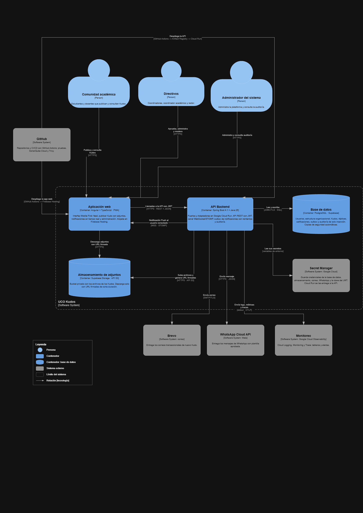

# 09 · Arquitectura de Alto Nivel (Modelo C4) — UCO Kudos

## 1. Diagrama de Contexto (Nivel 1)

### 1.1 Elementos del contexto

| Elemento | Tipo | Descripción | Relación con UCO Kudos |
|---|---|---|---|
| Comunidad académica | Persona | Estudiantes y docentes (≈ 90 % desde el celular, DRV-001). | Publican y consultan Kudos; reciben notificaciones Push si están conectados. |
| Directivos | Persona | Coordinador de programa, coordinador de facultad, coordinador académico y rector. | Aprueban solicitudes según la jerarquía, administran categorías (académico y rector) y vetan contenido (académico y rector). |
| Administrador del sistema | Persona | Responsable técnico y de gobierno de la plataforma. | Gestiona administradores y rector; consulta auditoría y observabilidad. |
| Servicio de correo (Brevo) | Sistema externo | Proveedor de correo transaccional (ADR-005). | Recibe la orden de envío del correo de nuevo Kudo. |
| Traccar SMS Gateway | Sistema externo | Pasarela SMS: API en la nube y celular Android que envía el mensaje (ADR-015). Reemplaza a WhatsApp Business Platform, rechazado en el ADR-006. | Recibe la orden de envío del SMS de nuevo Kudo. |
| GitHub | Sistema externo | Repositorios y CI/CD con GitHub Actions (ADR-011). | Compila, prueba, analiza (SonarQube Cloud, Trivy) y despliega UCO Kudos. |
| Monitoreo (Google Cloud Observability) | Sistema externo | Cloud Logging, Monitoring y Trace (ADR-012). | Recibe logs, métricas y trazas; el administrador consulta tableros y alertas. |

---

## 2. Diagrama de Contenedores (Nivel 2)

### 2.1 Contenedores

| Contenedor | Tecnología | Responsabilidad | Despliegue | ADR |
|---|---|---|---|---|
| **Aplicación web** | Angular, PWA, RxStomp | Interfaz Mobile First; autenticación del usuario (guarda y envía el JWT); recibe las notificaciones Push por WebSocket. | Firebase Hosting (sitio estático con HTTPS y CDN) | ADR-014, ADR-010 |
| **API de UCO Kudos** | Java 25, Spring Boot 4.1, Spring Security, Spring WebSocket | Reglas de negocio y casos de uso; API REST; canal WebSocket/STOMP; procesamiento asíncrono del outbox; auditoría. Una sola unidad desplegable organizada con Puertos y Adaptadores. | Imagen Docker en Google Cloud Run | ADR-001, ADR-002, ADR-004, ADR-008, ADR-010 |
| **Base de datos** | PostgreSQL gestionado (Supabase), migraciones Flyway | Persistencia transaccional; restricciones de unicidad de roles; tabla outbox; auditoría de solo inserción. | Supabase | ADR-003, ADR-013 |
| **Almacenamiento de adjuntos** | Supabase Storage (API compatible con S3) | Guarda los archivos en un bucket privado; descarga solo mediante URL firmadas de corta duración. | Supabase | ADR-007 |

### 2.2 Servicios externos

| Servicio | Uso | Protocolo | ADR |
|---|---|---|---|
| Brevo | Correo transaccional del nuevo Kudo | SMTP sobre TLS | ADR-005 |
| Traccar SMS Gateway | SMS con el autor, la categoría y el enlace al Kudo | HTTPS/JSON con token | ADR-015 (reemplaza ADR-006) |
| Google Cloud Observability (Monitoreo) | Logs, métricas, trazas y tableros | Salida estándar (logs JSON) y OTLP | ADR-012 |
| Secret Manager (Google Cloud) | Guarda las credenciales y la clave del JWT; Cloud Run se las entrega a la API como variables de entorno | Variables de entorno | ADR-008, ADR-010 |
| GitHub | CI/CD: despliega la API en Cloud Run (vía Artifact Registry) y la aplicación web en Firebase Hosting | GitHub Actions | ADR-011 |

