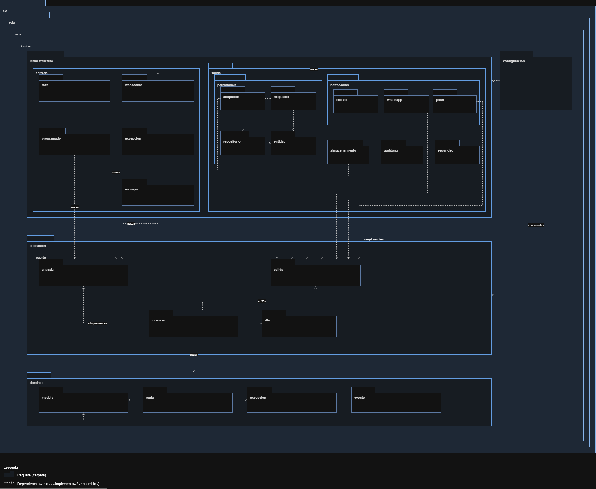
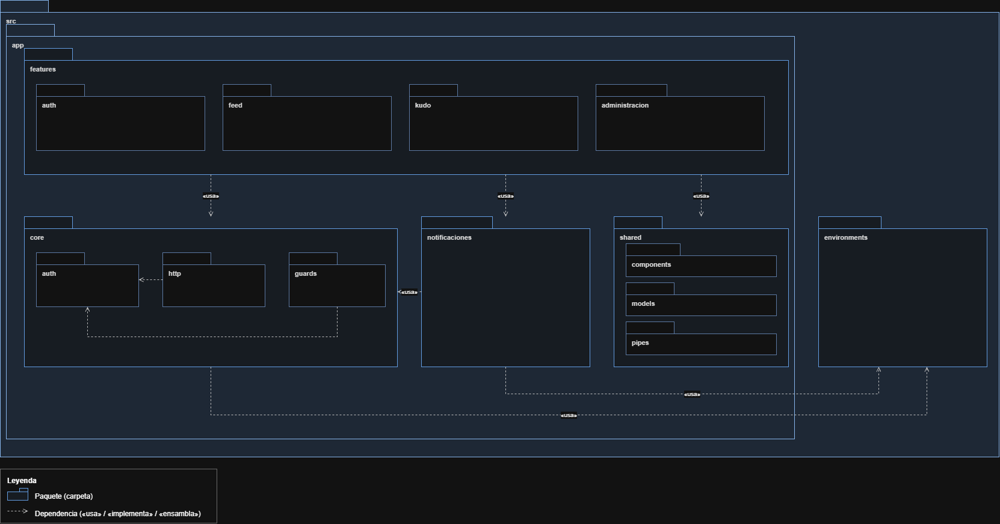
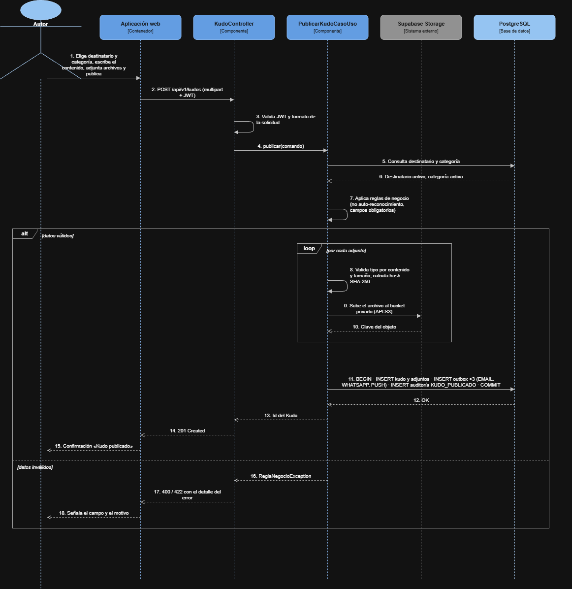
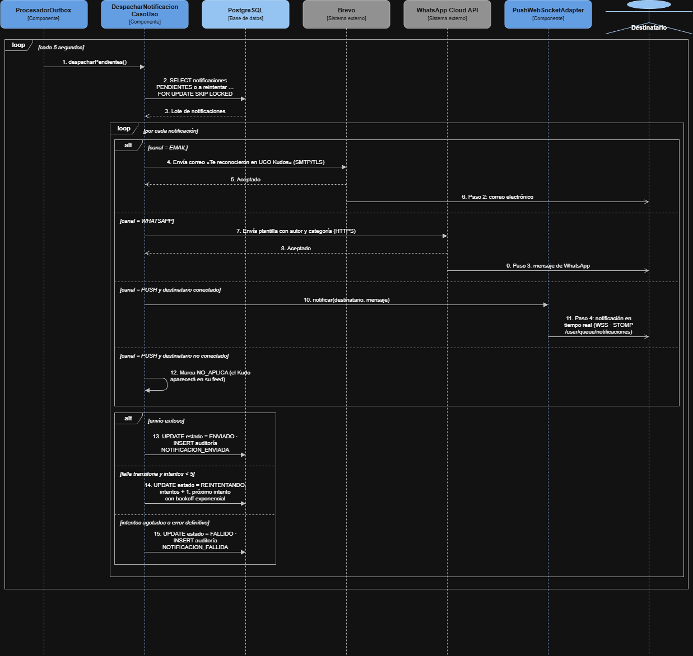
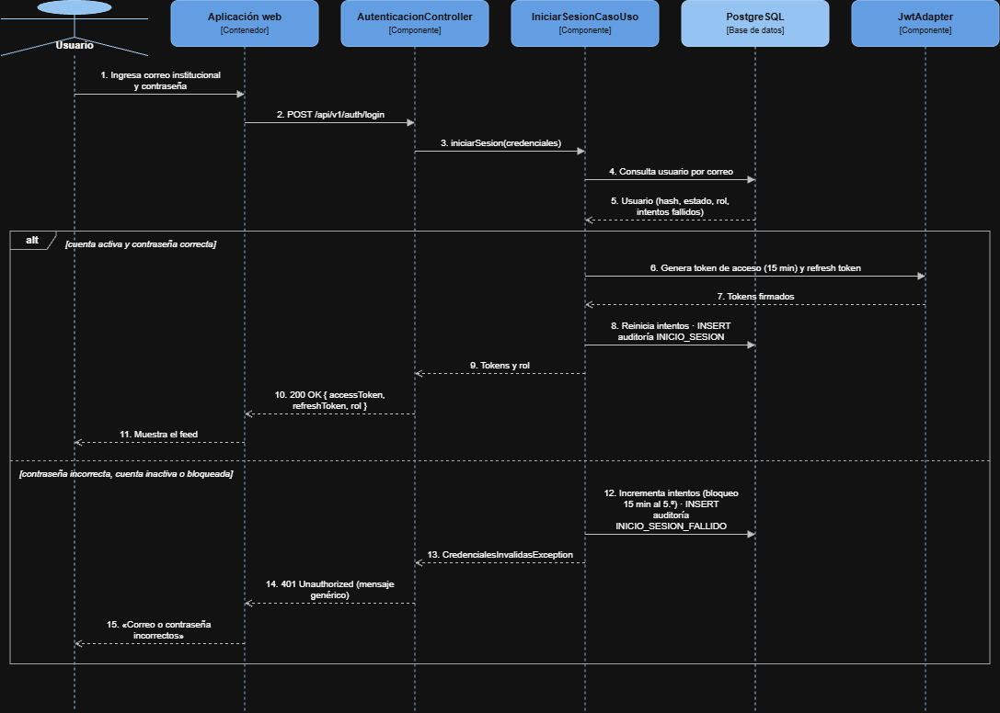
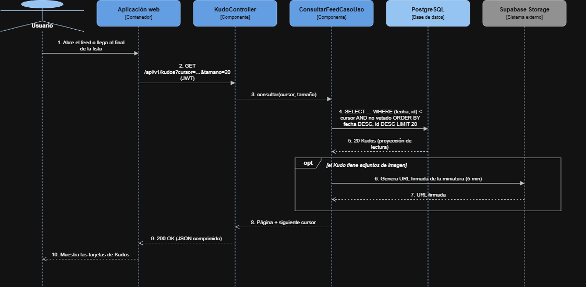
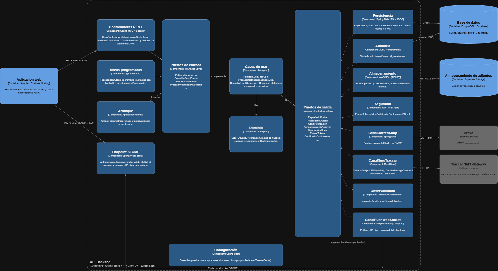

# 10 · Diseño Detallado — UCO Kudos

## 1. Diagrama de paquetes

### 1.1 Back-end (API)

Estructura: `co` → `edu` → `uco` → `kudos`, y dentro las capas de Puertos y Adaptadores.

| Carpeta | Subcarpetas | Responsabilidad | Depende de |
|---|---|---|---|
| `dominio` | `modelo`, `regla`, `excepcion`, `evento` | Entidades, reglas de negocio (exclusividad y unicidad de roles, reglas del Kudo), excepciones y eventos. No usa Spring ni JPA. | — |
| `aplicacion/puerto` | `entrada`, `salida` | Interfaces del núcleo: las de entrada las implementan los casos de uso; las de salida las implementa la infraestructura. | `dominio` |
| `aplicacion/casouso` | — | Implementa los puertos de entrada orquestando el dominio y los puertos de salida. | `puerto/entrada`, `puerto/salida`, `dto`, `dominio` |
| `aplicacion/dto` | — | Comandos y resultados que entran y salen de los casos de uso. | — |
| `infraestructura/entrada` | `rest`, `websocket`, `programado`, `arranque`, `excepcion` | Recibe peticiones HTTP, conexiones STOMP y la ejecución periódica del outbox; al iniciar la aplicación crea el administrador inicial; traduce errores a respuestas HTTP. | `aplicacion/puerto/entrada` |
| `infraestructura/salida` | `persistencia` (`adaptador`, `mapeador`, `repositorio`, `entidad`, `consulta`, `jdbc`), `notificacion` (`correo`, `sms`, `push`), `almacenamiento`, `auditoria`, `seguridad`, `observabilidad` | Implementa los puertos de salida con tecnologías concretas. En `persistencia`, el adaptador usa el repositorio y el mapeador, que convierten entre entidades JPA y el modelo de dominio; `consulta` resuelve las lecturas del feed, categorías y usuarios (CQRS ligero, ADR-009); `jdbc` implementa con SQL directo los puertos de registro, estructura, réplicas, calificaciones, moderación, auditoría y limpieza. `push` envía por `entrada/websocket`. `observabilidad` publica métricas del outbox leyendo el repositorio. | `aplicacion/puerto/salida`, `dominio` |
| `configuracion` | — | Ensambla puertos con adaptadores, seguridad, reintentos, observabilidad y propiedades por entorno. | `infraestructura`, `aplicacion` |

**Reglas arquitectónicas (verificadas con ArchUnit en CI):**
1. `dominio` no depende de ningún otro paquete ni de frameworks.
2. `aplicacion` solo depende de `dominio`.
3. `infraestructura` depende de los puertos; el núcleo nunca depende de `infraestructura`.
4. Los controladores solo invocan puertos de entrada, nunca repositorios ni adaptadores de salida.

### 1.2 Front-end (aplicación web)

Estructura: `src` → `app` y `environments`.

| Carpeta | Subcarpetas | Responsabilidad | Depende de |
|---|---|---|---|
| `app/features` | `auth`, `feed`, `kudo`, `administracion` | Funcionalidades cargadas bajo demanda. | `core`, `notificaciones`, `shared` |
| `app/core` | `auth`, `http`, `guards` | Sesión y JWT; `http` y `guards` usan `auth` para agregar el token y proteger rutas. | `environments` |
| `app/notificaciones` | — | Conexión STOMP con reconexión automática y visualización de las notificaciones Push. | `core`, `environments` |
| `app/shared` | `components`, `models`, `pipes` | Componentes visuales Mobile First, modelos y utilidades reutilizables. | — |
| `environments` | — | URL de la API y del WebSocket por entorno. | — |

---

## 2. Diagramas de secuencia

### 2.1 Publicar Kudo (paso 1 del flujo obligatorio)

### 2.2 Notificación multicanal

### 2.3 Iniciar sesión

### 2.4 Consultar feed

---

## 3. Diagrama de componentes (C4 nivel 3 · API)

Muestra los componentes internos del contenedor **API (Spring Boot)** y cómo se conectan con los demás contenedores y sistemas externos del C4 nivel 2. Las flechas siguen la regla de dependencias: los adaptadores de entrada llaman a puertos de entrada, los casos de uso usan puertos de salida y la infraestructura los implementa.

Fuente editable: `diagramas/Diagrama_Componentes.drawio`.

| Componente | Responsabilidad | Tecnología |
|---|---|---|
| Controladores REST | Exponen la API, validan la entrada y obtienen el usuario autenticado del JWT. | Spring MVC, Spring Security |
| Endpoint STOMP | Autentica la conexión WebSocket con JWT y entrega las notificaciones Push al destinatario. | Spring WebSocket / STOMP |
| Tareas programadas | Procesan el outbox con reintentos y *backoff* y limpian datos vencidos. | `@Scheduled` |
| Puertos de entrada y casos de uso | Orquestan cada funcionalidad (publicar Kudo, feed, registro, moderación, auditoría). | Java 25, sin frameworks en el núcleo |
| Dominio | Entidades, reglas de negocio y eventos. | Java puro |
| Persistencia | Implementa repositorios (JPA), lecturas del feed (CQRS ligero) y operaciones SQL directas. | Spring Data JPA, JDBC, Flyway |
| Canales de notificación | Correo (SMTP), canal móvil (SMS por Traccar) y Push. | Spring Mail, RestClient, STOMP |
| Almacenamiento | Guarda adjuntos en un bucket privado y genera URL firmadas. | AWS SDK (API S3 de Supabase) |
| Auditoría | Registra cada paso en una tabla de solo inserción, con métricas. | JDBC, Micrometer |
| Seguridad | Emite y valida JWT; cifra contraseñas. | JJWT, BCrypt |
| Configuración | Selecciona los adaptadores por propiedades (Twelve-Factor) y los conecta a los puertos. | Spring Boot |
