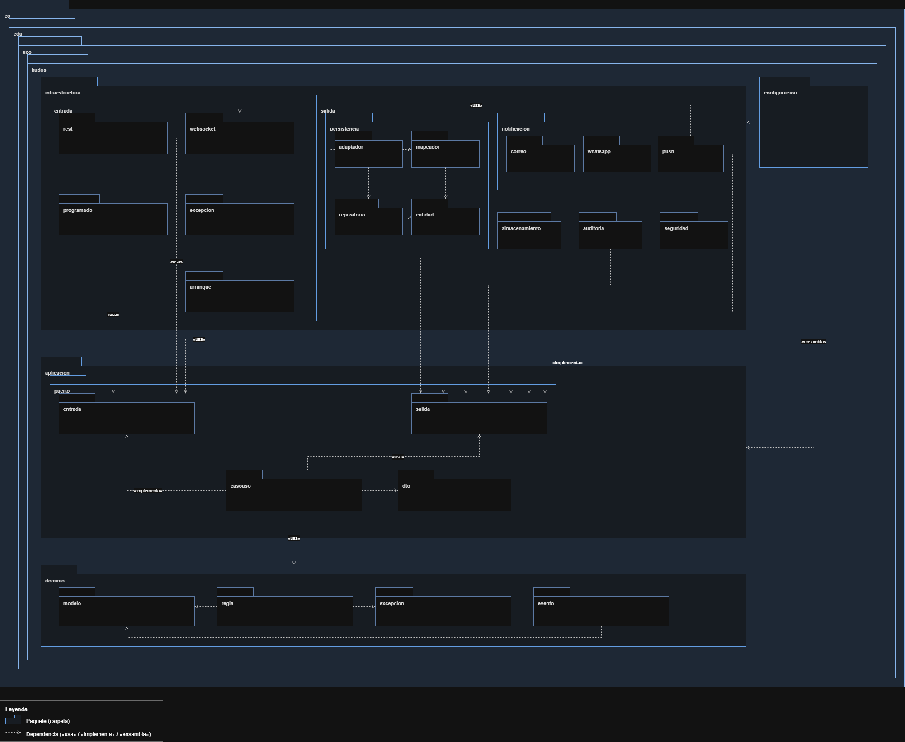

# 11 · Clean Architecture — UCO Kudos

## 1. Relación entre Clean Architecture y Puertos y Adaptadores

La solución organiza el back-end con **Puertos y Adaptadores** (ADR-001). Esta es una forma concreta de aplicar **Clean Architecture**: ambas comparten la **regla de dependencia**, según la cual el código de negocio no depende de frameworks, bases de datos ni proveedores externos.

| Círculo de Clean Architecture | Carpeta en UCO Kudos | Contenido |
|---|---|---|
| Entidades (reglas de negocio de la empresa) | `dominio` | `modelo`, `regla`, `excepcion`, `evento` |
| Casos de uso (reglas de negocio de la aplicación) | `aplicacion` | `casouso`, `puerto/entrada`, `puerto/salida`, `dto` |
| Adaptadores de interfaz | `infraestructura` | `entrada` (REST, WebSocket, tarea programada) y `salida` (persistencia, notificación, almacenamiento, auditoría, seguridad) |
| Frameworks y controladores | Spring Boot, PostgreSQL, Supabase Storage, Brevo, Traccar SMS Gateway | Se conectan solo a través de `infraestructura` y se ensamblan en `configuracion` |



---

## 2. Capas y responsabilidades

| Capa | Responsabilidad | Lo que **sí** contiene | Lo que **no** contiene |
|---|---|---|---|
| **Dominio** | Representar el negocio de UCO Kudos y sus reglas. | Kudo, Usuario, Categoría, roles; reglas como "no reconocerse a sí mismo" o "un único rol activo"; eventos como `KudoPublicado`. | Anotaciones de Spring o JPA, SQL, HTTP, JSON. |
| **Aplicación** | Coordinar los casos de uso del sistema. | Casos de uso (Publicar Kudo, Consultar feed, Despachar notificación…); interfaces de entrada y de salida (puertos); comandos y resultados (DTO). | Detalles de cómo se guarda, se envía o se expone la información. |
| **Infraestructura** | Conectar el núcleo con el mundo exterior. | Controladores REST, WebSocket, tarea del outbox, adaptadores JPA, de correo, SMS, Push, almacenamiento S3, auditoría y JWT. | Reglas de negocio. |
| **Configuración** | Ensamblar la aplicación. | Seguridad, inyección de dependencias (qué adaptador implementa cada puerto), propiedades por entorno. | Lógica de negocio. |

---

## 3. Dependencias

```text
infraestructura ──► aplicacion ──► dominio
       │                 ▲
       └── implementa ───┘ (puertos de salida)

configuracion ──► ensambla infraestructura + aplicacion
```

- Las dependencias **siempre apuntan hacia el dominio**.
- La aplicación necesita guardar un Kudo o enviar un correo, pero **no conoce** PostgreSQL ni Brevo: define una interfaz (puerto de salida) y la infraestructura la implementa. Esto es la **Inversión de Dependencias** (la D de SOLID).
- Los datos sí viajan en ambos sentidos (la petición entra y la respuesta sale), pero el **código** solo depende hacia adentro.

**Ejemplo con Publicar Kudo:**
1. `infraestructura/entrada/rest` recibe la petición HTTP y llama al puerto de entrada.
2. `aplicacion/casouso` aplica las reglas del `dominio` y llama a los puertos de salida.
3. `infraestructura/salida/persistencia` guarda el Kudo en PostgreSQL; `infraestructura/salida/notificacion` se encarga después del correo, el SMS y el Push.
4. El caso de uso nunca supo qué base de datos ni qué proveedor de correo se usó.

---

## 4. Reglas arquitectónicas

| # | Regla | Cómo se garantiza |
|---|---|---|
| 1 | `dominio` no depende de ninguna otra carpeta ni de frameworks (`org.springframework`, `jakarta.persistence`). | Prueba automática con ArchUnit en el pipeline de CI. |
| 2 | `aplicacion` solo depende de `dominio`. | Prueba automática con ArchUnit. |
| 3 | `infraestructura` depende de los puertos; nada del núcleo depende de `infraestructura`. | Prueba automática con ArchUnit. |
| 4 | Los controladores solo invocan puertos de entrada, nunca repositorios ni adaptadores de salida. | Prueba automática con ArchUnit. |
| 5 | Las entidades JPA (`persistencia/entidad`) no salen de la infraestructura; se convierten al modelo de dominio con el `mapeador`. | Revisión de código y prueba de arquitectura. |
| 6 | Cada adaptador de salida implementa exactamente un puerto y encapsula una sola tecnología. | Diseño (SRP) y revisión de código. |


---

## 5. Beneficios obtenidos

| Beneficio | Ejemplo en UCO Kudos |
|---|---|
| Cambiar de proveedor sin tocar el negocio | Pasar de WhatsApp Cloud API a SMS con Traccar fue crear el adaptador `CanalSmsTraccar` de `CanalNotificacion` y registrarlo en la configuración, sin tocar dominio ni casos de uso (ADR-006 → ADR-015). |
| Probar el negocio sin infraestructura | Los casos de uso se prueban con dobles de los puertos, sin base de datos ni Spring. |
| Agregar funcionalidades sin romper otras | Un nuevo canal de notificación (por ejemplo, SMS) no modifica `PublicarKudo`. |
| Cambios localizados | Durante la sustentación, un cambio de regla se hace en `dominio`; un cambio de proveedor, en `infraestructura`. |
