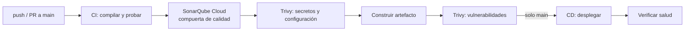

# 18 · DevSecOps — UCO Kudos

Cada repositorio tiene su propio pipeline en GitHub Actions (`.github/workflows/ci-cd.yml`), que se ejecuta en cada *push* y *pull request* a `main`. La seguridad y la calidad son compuertas: si una falla, nada se despliega (ADR-011).

## 1. Flujo general

## 2. CI — Integración continua

| Etapa | Back-end | Front-end | Se detiene si |
|---|---|---|---|
| Obtener código | `actions/checkout` con historial completo (Sonar lo necesita para el análisis nuevo) | Igual | — |
| Entorno | Java 25 Temurin con caché de Maven | Node.js con caché de npm | — |
| Compilar y probar | `./mvnw verify`: compila, 195 pruebas (unitarias, arquitectura, MockMvc y PostgreSQL en Testcontainers) y reporte JaCoCo | `npm ci`, pruebas con cobertura `lcov`, build de producción | Falla una prueba o la compilación |
| Reportes | Sube los reportes de Surefire y JaCoCo como artefacto (7 días) | Igual | — |

## 3. Sonar — Análisis estático (obligatorio)

| Aspecto | Configuración |
|---|---|
| Servicio | **SonarQube Cloud** (gratuito para repositorios públicos). |
| Back-end | `./mvnw sonar:sonar` con `sonar.coverage.jacoco.xmlReportPaths` apuntando a `jacoco.xml`. Excluye de la cobertura `KudosApplication` y `Propiedades*`. |
| Front-end | `sonar-project.properties` con `sonar.javascript.lcov.reportPaths`. |
| Compuerta | `-Dsonar.qualitygate.wait=true`: el pipeline **espera el resultado y falla** si el código nuevo no cumple la compuerta (*Sonar way*: cobertura, duplicación, *bugs*, vulnerabilidades y *security hotspots* revisados). |
| Credenciales | `SONAR_TOKEN` como *secret* de GitHub; organización y proyecto como variables (`SONAR_ORGANIZACION`, `SONAR_PROYECTO`). |

## 4. Trivy — Escaneo de vulnerabilidades (obligatorio)

| Escaneo | Comando | Política |
|---|---|---|
| Repositorio: secretos y configuración | `trivy fs --scanners secret,misconfig --severity HIGH,CRITICAL` | Falla con cualquier secreto o mala configuración HIGH o CRITICAL (por ejemplo, un `Dockerfile` que corre como *root*). |
| Imagen Docker del back-end | `trivy image --severity CRITICAL --ignore-unfixed` | Falla con vulnerabilidades CRITICAL que ya tienen corrección. |
| Dependencias del front-end | `trivy fs` sobre `package-lock.json` | Falla con vulnerabilidades CRITICAL. |

La versión de Trivy está fijada (`aquasec/trivy:0.58.1`) para que el resultado sea reproducible.

## 5. CD — Despliegue automatizado

| Aspecto | Back-end | Front-end |
|---|---|---|
| Cuándo | Solo en `main` y nunca en *pull requests* | Igual |
| Artefacto | Imagen Docker multietapa: compila con JDK 25 y ejecuta con JRE 25, por capas, con usuario sin privilegios (`USER kudos`) | Build de producción de Angular |
| Destino | **Google Cloud Run**: la imagen se publica en Artifact Registry con la etiqueta del *commit* (`github.sha`) y se despliega | **Firebase Hosting** con `FirebaseExtended/action-hosting-deploy` |
| Autenticación | **Workload Identity Federation**: GitHub obtiene credenciales temporales de Google sin guardar ninguna llave | Cuenta de servicio de Firebase en el *secret* `FIREBASE_SERVICE_ACCOUNT` |
| Configuración | Variables con `--update-env-vars` y secretos de **Secret Manager** con `--update-secrets` | `environment.ts` con la URL de la API |
| Entorno | *Environment* `produccion` de GitHub (permite exigir aprobación manual) | Igual |
| Verificación | Espera a que `/actuator/health` responda (10 reintentos) | Firebase confirma la publicación |
| Reversión | Cada despliegue es una revisión inmutable de Cloud Run: se puede volver a la anterior desde la consola o con `gcloud run services update-traffic` | Firebase guarda las versiones anteriores y permite revertir con un clic |

**Parámetros de Cloud Run y por qué:**

| Parámetro | Valor | Motivo |
|---|---|---|
| `--max-instances` | 1 | El Push usa un *broker* STOMP en memoria: con dos instancias, un usuario conectado a una no recibiría lo publicado en la otra. |
| `--no-cpu-throttling` | — | El procesador del outbox es una tarea programada; sin CPU fuera de las peticiones, Cloud Run lo congelaría. |
| `--cpu-boost` | — | Más CPU durante el arranque para reducir el arranque en frío. |
| `--min-instances` | 1 | Evita el arranque en frío que hacía que el front mostrara "No hay conexión" (ADR-010, aceptado con cambios). |
| Perfil | `SPRING_PROFILES_ACTIVE=cloud` | Logs JSON para Cloud Logging y apagado ordenado. |

## 6. Prácticas de seguridad del pipeline

| Práctica | Aplicación |
|---|---|
| Mínimo privilegio | `permissions: contents: read` por defecto; `id-token: write` solo en el trabajo de despliegue. La cuenta de despliegue solo tiene *Cloud Run Admin*, *Artifact Registry Writer* y *Service Account User*; la de ejecución solo *Secret Accessor*. |
| Sin llaves de larga duración | Workload Identity Federation en lugar de un JSON de cuenta de servicio. |
| Secretos fuera del repositorio | Secret Manager (producción) y GitHub Secrets (pipeline); Trivy verifica que no se cuelen en el código. |
| Trazabilidad | Cada imagen lleva el SHA del *commit*; cada ejecución deja reportes de pruebas y cobertura. |
| Ejecuciones concurrentes | `concurrency` cancela la ejecución anterior de la misma rama para no desplegar versiones viejas. |
| Contenedor endurecido | Imagen JRE (sin compilador), usuario sin privilegios, `ExitOnOutOfMemoryError`, memoria limitada al 75 % del contenedor. |

## 7. Observabilidad en producción (cierra el ciclo DevOps)

| Señal | Fuente | Dónde se ve |
|---|---|---|
| Logs | JSON (formato Logstash) con `severity`, `traceId` y `spanId` | Cloud Logging |
| Métricas de negocio | `kudos.publicados`, `kudos.notificaciones{canal,resultado}`, `kudos.outbox.notificaciones{estado}`, `kudos.sesiones{resultado}`, `kudos.auditoria.eventos{accion,resultado}` | `/actuator/metrics` (ADMINISTRADOR) y Cloud Monitoring por OTLP |
| Trazas | Micrometer Tracing + OpenTelemetry (muestreo del 10 %) | Cloud Trace |
| Salud | `/actuator/health` con sondas de inicio y disponibilidad | Cloud Run y el paso de verificación del pipeline |
| Auditoría | Tabla `registro_auditoria` append-only | `GET /api/v1/auditoria` |

## 8. Evidencias a guardar para la entrega

- Ejecución en verde de la pestaña **Actions** de cada repositorio, con sus tres trabajos.
- Panel del proyecto en **SonarQube Cloud** con la compuerta de calidad aprobada y la cobertura.
- Salida de **Trivy** en el registro del pipeline (secretos, configuración e imagen).
- Servicio en **Cloud Run** con la revisión desplegada y la URL pública.
- Sitio en **Firebase Hosting** con la URL pública del front-end.
